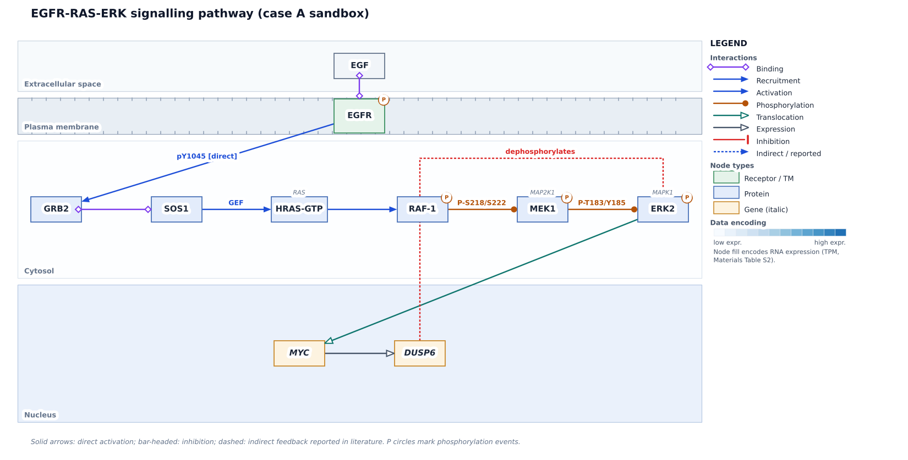

# bio-pathway-figure — Agent Skill for Biological Mechanism & Pathway Diagrams

Deterministic, auditable scientific figure generation for biological mechanism /
pathway maps. Built as an agent-loadable **Skill** (SKILL.md + pure-Python stdlib
engine) for the Agentic Science Challenge (PKU) efficiency track, challenge
`challenge-83d4f050` (生物机制图与通路图 / Biological Mechanism and Pathway Diagrams).

Given a structured `spec.json` describing entities, interactions, compartments and
(optional) quantitative data, the engine renders **the same geometry** to three
deliverables:

- `fig.svg` — layered, element-id-tagged, font-stack-replaceable editable source
- `fig.png` — raster export (matplotlib; cairosvg/rsvg fallback chain)
- `fig.pdf` — vector export

…plus machine-readable `fig.checks.json` (geometry/legend audit),
`fig.summary.json` and a provenance draft `fig.content-map.json` for the
case `result.json` contract.



## Design guarantees

| Guarantee | How |
|---|---|
| Every arrow has semantics | 10-type edge taxonomy (activation ▶ / inhibition ⊣ / binding ◇ / phosphorylation ● / ubiquitination / transport ▷ / translocation / recruitment / expression / other), fixed colors + endpoints, legend auto-generated **from the styles actually used** so legend ≡ map |
| Topology is readable | Receptors span the membrane band; exterior → membrane → cytosol → nucleus flow; feedback loops route above; optional `layout.auto_arc` routes pass-behind-node edges as staggered arcs |
| Results are verifiable | Built-in multi-scale layout search + `check_figure.py` independent SVG audit (bounds / overlap / legend presence); ships only at 0 violations or declares honest exceptions |
| Source stays editable | Pure-string SVG writer with `id="shape-EGFR"`, `id="label-HRAS"`, `id="edge-4-RAF1-MAP2K1"`; `edit_svg.py` rewrites only matched fragments and emits a before/after record |
| Reruns are stable | Deterministic layout — same spec in, same figure out |

## Quickstart

```bash
python3 scripts/make_figure.py --spec spec.json --outdir out --basename fig --dpi 300
python3 scripts/check_figure.py out/fig.svg          # independent audit, exit 0 = clean
python3 scripts/result_contract.py --check result.json
```

Spec schema: [`references/spec_schema.md`](references/spec_schema.md) ·
arrow semantics: [`references/arrow_semantics.md`](references/arrow_semantics.md) ·
naming/layout/no-script fallback: [`references/layout_rules.md`](references/layout_rules.md) ·
result.json template & honesty rules: [`references/checklist.md`](references/checklist.md).

Chart mode (for pathway-adjacent quantitative panels) draws bars + SEM error bars +
significance brackets with nice ticks and negative-value support:
[`examples/qpcr_fold_change_chart.png`](examples/qpcr_fold_change_chart.png).

Dependencies: Python 3.9+ standard library; matplotlib for PNG/PDF (optional —
SVG rasterizer fallbacks cover raster export).

## Example figures

| Figure | Notes |
|---|---|
| [EGFR–RAS–ERK cascade](examples/egfr_ras_erk_mechanism.png) | 4 compartments, transmembrane receptor, P-site labels, dashed inhibitory feedback, expression edges |
| [UV-B response stress cascade](examples/uv_response_stress_cascade.png) | 13 nodes, phosphorylation rails, corner P-mods, value-encoded node heights (`size_map`) |
| [qPCR fold-change panel](examples/qpcr_fold_change_chart.png) | group colors, SEM bars, significance brackets |

## Scope & honesty rules

The skill renders exactly what the source material states: dashed = indirect/reported,
`exceptions` field records material gaps, no invented entities/edges/numbers. Statuses
`ok / partial / failed` are explicit; partial results list their limits.

## License

MIT (skill code and docs). Example figures in `examples/` are synthetic sandbox
renders produced by this engine for demonstration.
